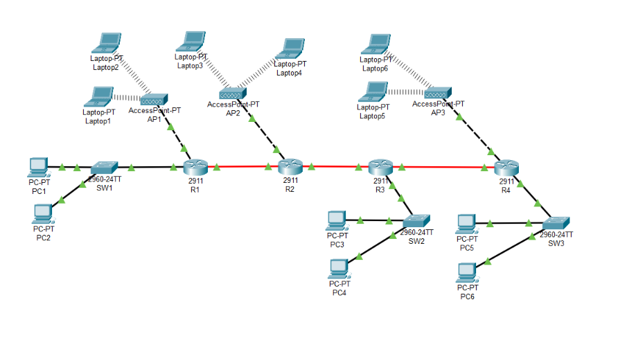
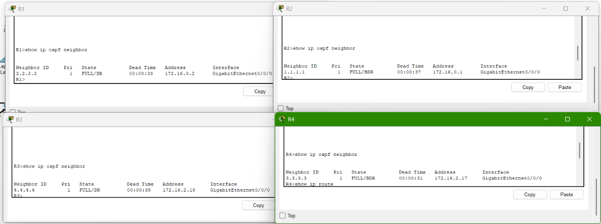
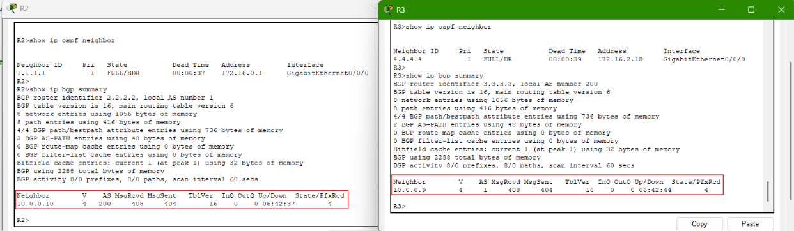
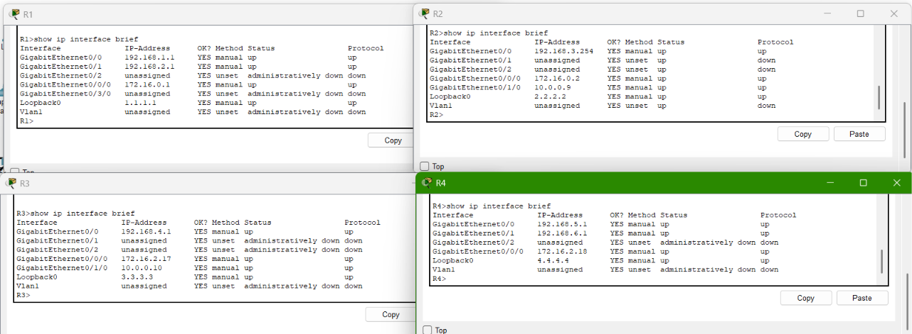
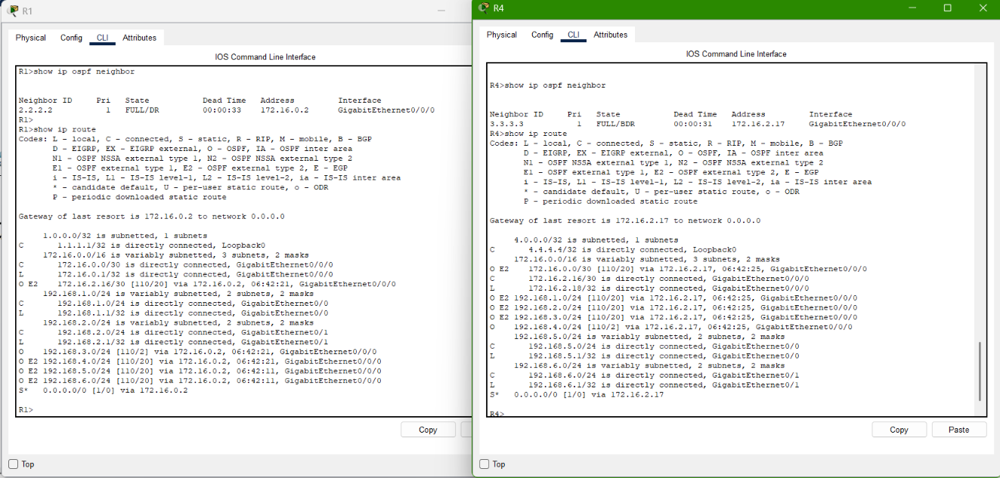
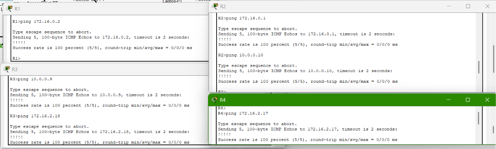
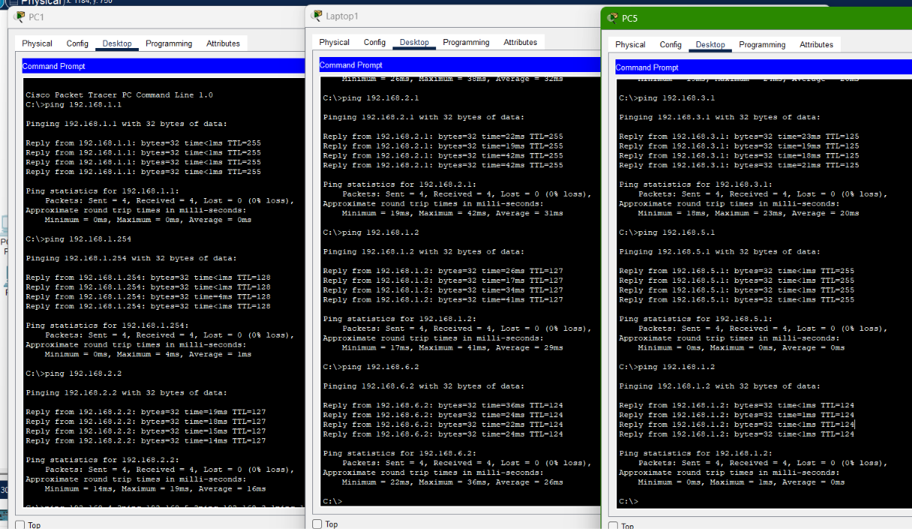
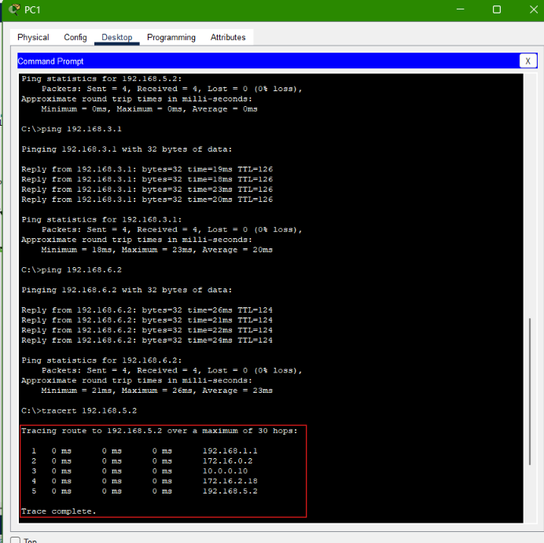

# Multi-Router Network Simulation: OSPF, eBGP, and Wireless LANs

**Platform:** Cisco Packet Tracer  
**Router:** R1, R2, R3, R4  
**Topik:** OSPF, eBGP, route redistribution, static default routing, wired LAN, dan wireless LAN

## 1. Ringkasan Proyek

Pada proyek ini, saya membangun simulasi jaringan multi-router menggunakan Cisco Packet Tracer. Jaringan terdiri dari empat router, tiga switch, tiga access point, enam PC, dan enam laptop. Routing internal menggunakan dua domain OSPF, sedangkan R2 dan R3 menghubungkan kedua sisi jaringan melalui eBGP antara AS 1 dan AS 200.

Proyek ini berfokus pada konfigurasi routing, pertukaran rute antar-domain, serta pengujian konektivitas dari jaringan kabel dan wireless ke subnet lain.

## 2. Topologi Jaringan



*Gambar 1. Topologi simulasi multi-router di Cisco Packet Tracer. [Lihat gambar ukuran penuh](evidence/01-topology.png).*

Topologi membentuk jalur router R1–R2–R3–R4. R1 melayani LAN `192.168.1.0/24` dan wireless `192.168.2.0/24`; R2 melayani wireless `192.168.3.0/24`; R3 melayani LAN `192.168.4.0/24`; sedangkan R4 melayani LAN `192.168.5.0/24` dan wireless `192.168.6.0/24`.

## 3. Skema Pengalamatan IPv4

| Segmen | Subnet | Gateway/alamat router |
|---|---|---|
| Wired LAN R1 | `192.168.1.0/24` | `192.168.1.1` |
| Wireless R1 | `192.168.2.0/24` | `192.168.2.1` |
| Wireless R2 | `192.168.3.0/24` | `192.168.3.254` |
| Wired LAN R3 | `192.168.4.0/24` | `192.168.4.1` |
| Wired LAN R4 | `192.168.5.0/24` | `192.168.5.1` |
| Wireless R4 | `192.168.6.0/24` | `192.168.6.1` |
| Transit R1–R2 | `172.16.0.0/30` | R1 `172.16.0.1` – R2 `172.16.0.2` |
| Transit R2–R3 | `10.0.0.8/30` | R2 `10.0.0.9` – R3 `10.0.0.10` |
| Transit R3–R4 | `172.16.2.16/30` | R3 `172.16.2.17` – R4 `172.16.2.18` |

## 4. Konfigurasi Routing

### 4.1 OSPF

- **R1–R2:** OSPF process 1, area 0.
- **R3–R4:** OSPF process 2, area 1.

Pemeriksaan dilakukan menggunakan `show ip ospf neighbor`. Kedua pasangan router menunjukkan status neighbor `FULL`.



*Gambar 2. Adjacency OSPF pada kedua pasangan router. [Lihat gambar ukuran penuh](evidence/03-ospf-neighbors.png).*

### 4.2 eBGP

R2 dikonfigurasi pada AS 1 dengan neighbor R3 `10.0.0.10` di AS 200. R3 berada pada AS 200 dan menggunakan neighbor R2 `10.0.0.9` di AS 1. Hasil `show ip bgp summary` menunjukkan empat prefix diterima pada masing-masing sisi.



*Gambar 3. Sesi eBGP R2–R3 dan jumlah prefix yang diterima. [Lihat gambar ukuran penuh](evidence/04-bgp-summary.png).*

### 4.3 Interface Router dan Routing Table

Saya memeriksa status interface melalui `show ip interface brief`. Interface yang digunakan dalam topologi menunjukkan status `up/up`.



*Gambar 4. Status interface router. [Lihat gambar ukuran penuh](evidence/02-router-interfaces.png).*

Routing table menunjukkan jaringan yang terhubung langsung (`C`), rute OSPF (`O`), rute OSPF external type 2 (`O E2`), dan static default route (`S*`). R1 menggunakan default route melalui `172.16.0.2`, sedangkan R4 menggunakan default route melalui `172.16.2.17`.



*Gambar 5. Routing table R1 dan R4. [Lihat gambar ukuran penuh](evidence/05-route-tables-r1-r4.png).*

## 5. Hasil Pengujian Konektivitas

### 5.1 Link Transit Antar-Router

Tiga link transit diuji menggunakan ping dari kedua sisi router. Pada beberapa percobaan awal, satu paket tidak mendapat balasan; setelah ping diulang, seluruh pengujian link transit mencapai `5/5` reply dengan success rate 100%.



*Gambar 6. Pengujian konektivitas link transit. Gambar memperlihatkan sebagian percobaan awal; hasil setelah ping diulang mencapai `5/5`. [Lihat gambar ukuran penuh](evidence/06-transit-pings.png).*

### 5.2 Konektivitas Endpoint

Pengujian dilakukan dari PC dan laptop untuk memverifikasi koneksi ke gateway, perangkat satu subnet, jaringan LAN/wireless yang terhubung ke router yang sama, serta jaringan di sisi router lain. Seluruh 49 ping endpoint yang dikumpulkan berhasil dengan empat paket diterima dan `0% packet loss`.



*Gambar 7. Hasil ping lokal dan lintas jaringan. [Lihat gambar ukuran penuh](evidence/07-endpoint-pings.png).*

### 5.3 Traceroute PC1 ke PC5

Dari PC1 (`192.168.1.2`), perintah berikut digunakan untuk melihat jalur menuju PC5 (`192.168.5.2`):

```text
tracert 192.168.5.2
```

Hasil traceroute menunjukkan jalur berikut hingga mencapai tujuan:

```text
192.168.1.1
172.16.0.2
10.0.0.10
172.16.2.18
192.168.5.2
```



*Gambar 8. Jalur traceroute dari PC1 ke PC5 melalui R1, R2, R3, dan R4. [Lihat gambar ukuran penuh](evidence/08-traceroute.png).*

## 6. Rekapitulasi Hasil Pengujian

| Pengujian | Jumlah | Hasil |
|---|---:|---|
| Ping pada link transit antar-router | 6 | Seluruhnya berhasil, `5/5` |
| Ping gateway dan peer satu subnet | 24 | Seluruhnya berhasil, `4/4` |
| Ping antara LAN dan wireless pada router yang sama | 4 | Seluruhnya berhasil, `4/4` |
| Ping lintas jaringan | 21 | Seluruhnya berhasil, `4/4` |
| Traceroute PC1 ke PC5 | 1 | Berhasil mencapai tujuan |
| Adjacency OSPF | 2 pasangan | Keduanya `FULL` |
| Sesi eBGP R2–R3 | 1 sesi | Established; empat prefix diterima di setiap sisi |

Secara keseluruhan, 49 ping dari end-device berhasil dengan `0% packet loss`. Enam pengujian ping transit antar-router juga berhasil pada hasil akhir dengan success rate 100%.

## 7. Catatan Konfigurasi Wireless

Access point digunakan untuk menghubungkan laptop ke subnet wireless masing-masing. Dalam konfigurasi simulasi ini, access point belum menggunakan autentikasi atau enkripsi wireless. Dengan demikian, pengujian wireless pada proyek ini berfokus pada konektivitas jaringan, bukan pada penerapan keamanan WLAN.

## 8. Kesimpulan

Simulasi jaringan berhasil menghubungkan empat router melalui dua domain OSPF dan eBGP antara AS 1 dan AS 200. Hasil pengujian menunjukkan adjacency OSPF mencapai `FULL`, sesi eBGP menerima empat prefix pada masing-masing sisi, dan end-device dapat berkomunikasi pada jaringan lokal maupun lintas subnet.

Traceroute dari PC1 menuju PC5 juga berhasil melewati R1, R2, R3, dan R4 hingga mencapai tujuan. Proyek ini menunjukkan penerapan dasar routing multi-router, pertukaran rute antar-AS, static default routing, serta konektivitas jaringan kabel dan wireless.
