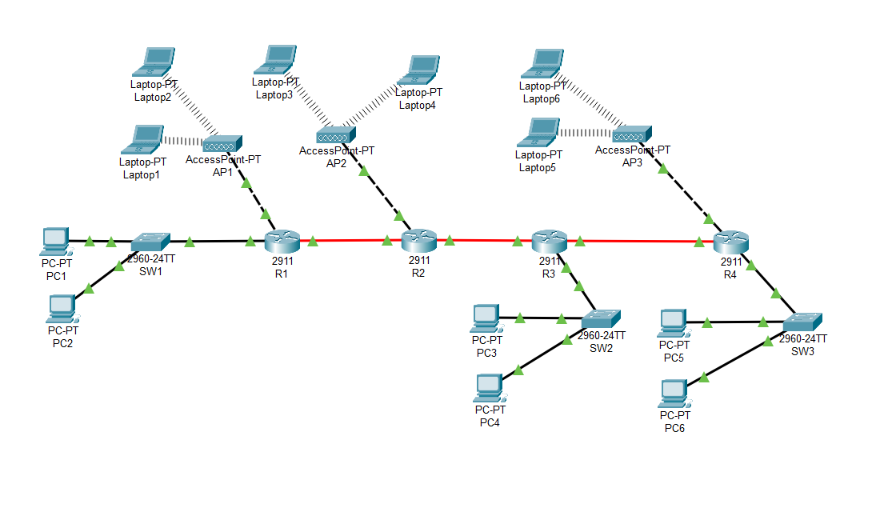

# Multi-Router Network Simulation: OSPF, eBGP, and Wireless LANs

Simulasi jaringan Cisco Packet Tracer yang menerapkan empat router, dua domain OSPF, eBGP antara AS 1 dan AS 200, route redistribution, static default routing, wired LAN, dan wireless LAN.

## Topologi

## Hasil utama

- Neighbor OSPF R1–R2 dan R3–R4 mencapai status `FULL`.
- Sesi eBGP R2–R3 terbentuk dan menerima empat prefix pada setiap sisi.
- Tiga link transit lulus pengujian ping pada hasil akhir.
- Sebanyak 49 ping end-device berhasil dengan `0% packet loss`.
- Traceroute PC1 (`192.168.1.2`) ke PC5 (`192.168.5.2`) mencapai tujuan melalui R1–R2–R3–R4.

Baca [laporan proyek lengkap dengan screenshot pada setiap bagian](Laporan_Proyek_Multi_Router.md). Semua gambar bukti berada di folder [`evidence/`](evidence/).

**Catatan:** simulasi wireless ini menguji konektivitas. Access point belum menerapkan autentikasi/enkripsi wireless.
